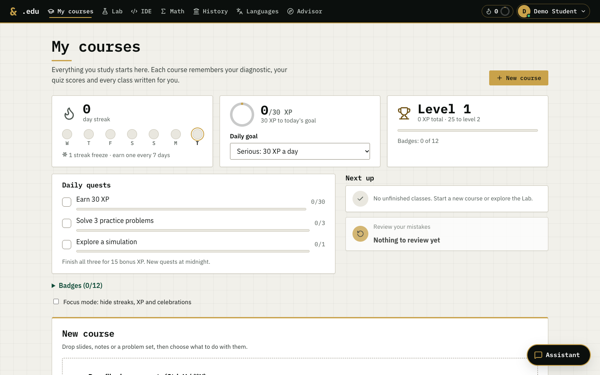
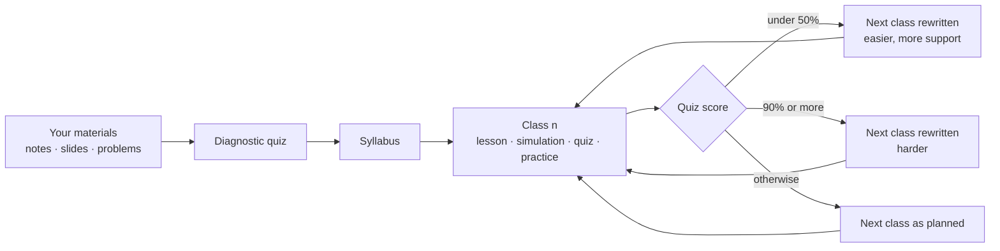
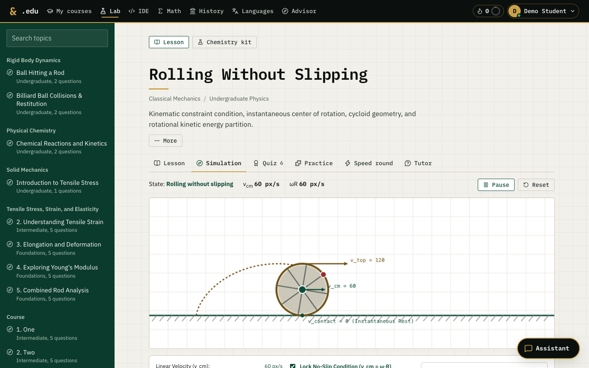
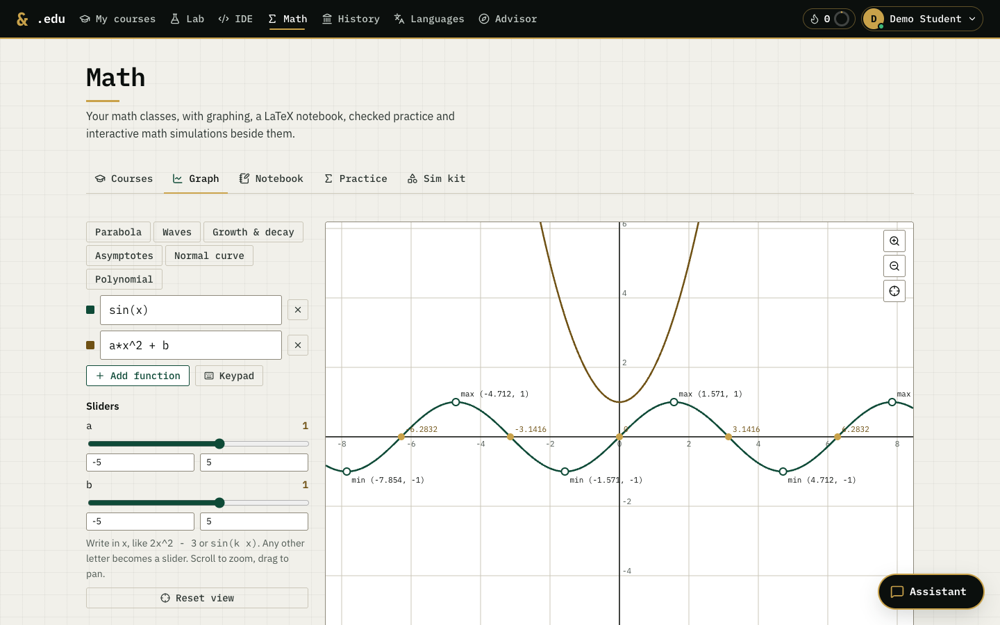
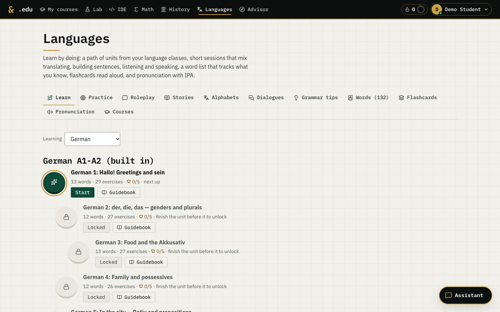
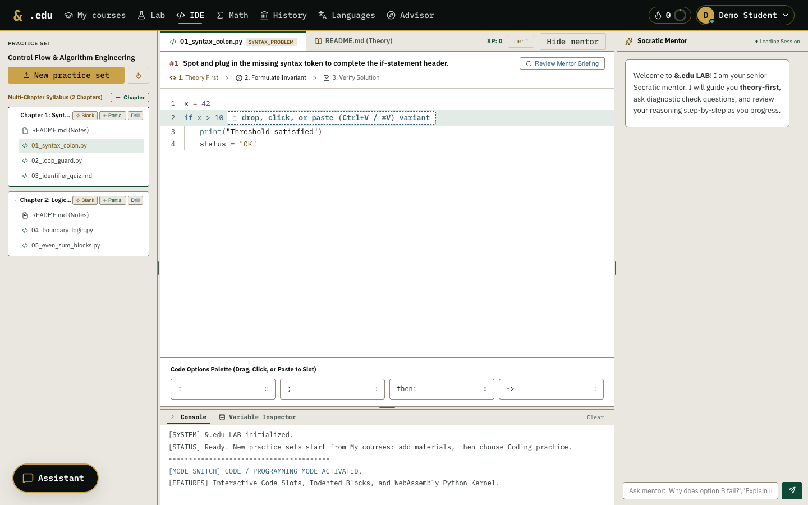
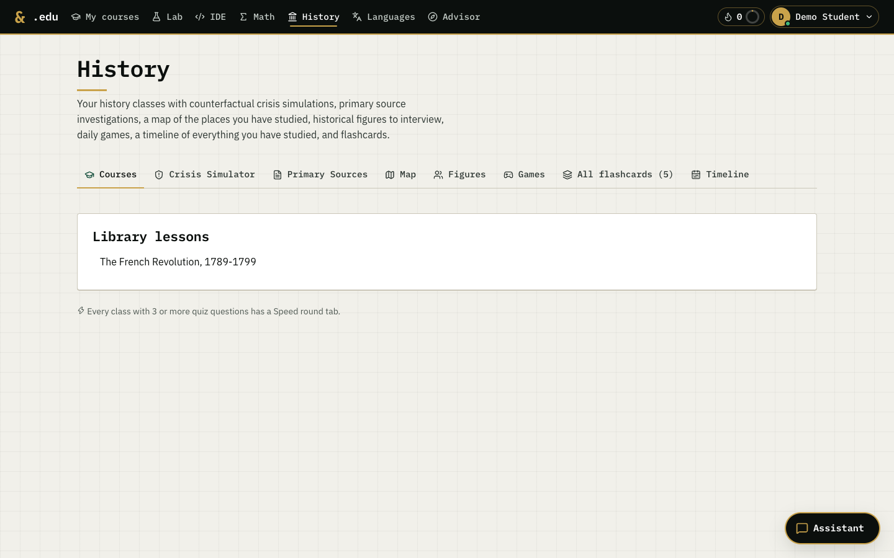
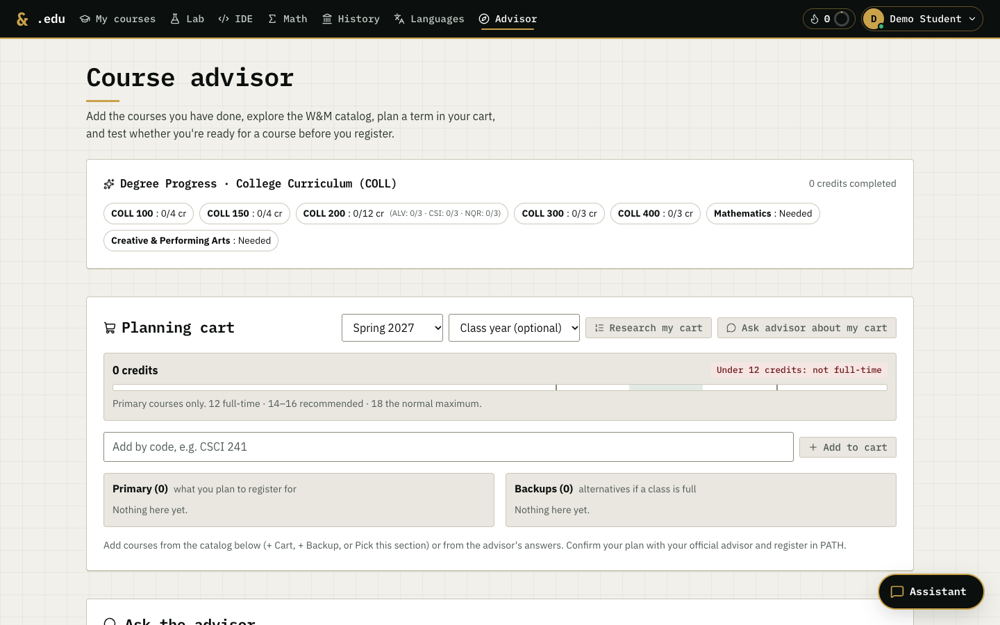

<div align="center">

# &amp;.edu

**Turn your course materials into a course that adapts to you.**

Upload notes, slides or a problem set. &.edu places you with a short diagnostic, writes an ordered sequence
of classes, and rewrites the next class when a quiz shows you are struggling or bored.


<picture><source media="(prefers-color-scheme: dark)" srcset="docs/images/home-dark.png"></picture>

</div>

Started at &hacks (best Gemini API usage); continued from the original &EDU.

## Contents
- [What it does](#what-it-does)
- [Workspaces](#workspaces)
- [Quick start](#quick-start)
- [Host it for a class or a university](#host-it-for-a-class-or-a-university)
- [For coding agents](#for-coding-agents)
- [Tests](#tests)
- [Where things are](#where-things-are)
- [Using it responsibly](#using-it-responsibly)
- [License](#license)

## What it does



- **Adaptive classes.** Each class has a lesson, a quiz, practice puzzles and often a simulation. Quiz results
  change the classes that come after it.
- **Checked answer keys.** A second model re-solves every diagnostic and class quiz. Each question is marked
  `verified`, `corrected`, `ambiguous` or `low-confidence`.
- **Course modes.** Learn a subject, prepare for an exam (`test_prep`), plan a whole semester (`semester`),
  work through your own problems step by step (`problem_sprint`), or continue a course with new materials.
- **Simulations as data.** Simulations are SimSpec v1 JSON (particles, graphs, math widgets, a chemistry kit).
  The browser runs them with its own small interpreter, so generated simulations never run as code.
- **Spaced review and streaks.** Every quiz question you miss comes back after 1, 3, 7, 14 and 30 days.
  XP, daily quests, badges and streak freezes are optional: Focus mode hides them.
- **Socratic tutor.** Gives short answers with one leading question, and never gives away answers to items
  you haven't tried yet.

## Workspaces

| | |
| --- | --- |
| <picture><source media="(prefers-color-scheme: dark)" srcset="docs/images/sim-dark.png"></picture> | <picture><source media="(prefers-color-scheme: dark)" srcset="docs/images/math-dark.png"></picture> |
| **Lab**: physics and chemistry lessons, live simulations, quizzes, speed rounds and a tutor. | **Math**: graphing with sliders, a LaTeX notebook, checked practice and a simulation kit. |
| <picture><source media="(prefers-color-scheme: dark)" srcset="docs/images/language-dark.png"></picture> | <picture><source media="(prefers-color-scheme: dark)" srcset="docs/images/code-dark.png"></picture> |
| **Languages**: a path of units, listening and speaking drills, stories, dialogues and IPA. A German A1–A2 course is built in and works offline. | **IDE**: practice sets made from your materials, code slots, a console and a Socratic mentor. |
| <picture><source media="(prefers-color-scheme: dark)" srcset="docs/images/history-dark.png"></picture> | <picture><source media="(prefers-color-scheme: dark)" srcset="docs/images/advisor-dark.png"></picture> |
| **History**: a crisis simulator, primary sources, an offline map, figures to interview, daily games and a timeline. | **Advisor**: your course record, the catalog, readiness checks, and a planning cart for each term with a credit gauge and time conflicts. |

Screenshots follow your GitHub theme. The app itself has light, dark and system themes.

## Quick start

You need Python 3 and Node.js.

```bash
python3 -m venv .venv && .venv/bin/pip install -r requirements.txt
npm install

echo 'GEMINI_API_KEY=your-key' > .env   # api_KEY also works

scripts/start.sh   # backend on 127.0.0.1:8090, app on http://localhost:5173
```

Sign in with a name, choose **New course**, add files and a goal.

> [!NOTE]
> After you change backend code, restart the backend. A server that is already running keeps the old code.

<details>
<summary>Optional <code>.env</code> settings</summary>

| Variable | Effect |
| --- | --- |
| `SCIEDU_PLANNER_MODELS` | Models for the diagnostic, the syllabus and answer checking (bigger), comma-separated |
| `SCIEDU_LESSON_MODELS` | Models for lessons, quizzes and practice (lighter) |
| `SCIEDU_GROUNDED_CHECKS=0` | Turn off Google Search grounding when answer keys are checked |
| `SCIEDU_DAILY_MODEL_CALLS` | Gemini requests per day across all features (default 400) |
| `SCIEDU_ELEVENLABS=1` | ElevenLabs audio in Languages and narration (needs a server key; daily character budgets apply) |
| `AGY_CLI=1` | Route the in-app assistant through the Antigravity CLI (see [`AGENTS.md`](AGENTS.md)) |

</details>

## Host it for a class or a university

The server refuses to start without accounts when other machines can reach it.

```bash
cp .env.example .env                        # fill in the Gemini key; SCIEDU_DOMAIN for HTTPS
cp Caddyfile.example Caddyfile
docker compose --profile tls up -d --build  # app + Caddy (automatic HTTPS on 80/443)
```

Put the domain in `SCIEDU_ALLOWED_HOSTS` in `docker-compose.yml`. Without `--profile tls` the app listens on
127.0.0.1:8090 only, so only the server itself can reach it.

Without Docker:

```bash
npm run build
SCIEDU_AUTH=1 SCIEDU_HOST=0.0.0.0 SCIEDU_ALLOWED_HOSTS=lab.example.edu python server.py
```

The backend serves the built app and the API on one port (8090). Data lives in `content/` (the SQLite
database, lessons and notes), or in the folder `SCIEDU_CONTENT_DIR` names.

## For coding agents

Agents can add lessons, quizzes, practice and simulations without touching frontend code. Every change is
validated and appears live in the UI.

- **MCP server:** [`mcp_server.py`](mcp_server.py) has no dependencies and talks to the running backend.
  Register it from the repo root:
  ```bash
  claude mcp add andedu -- python3 "$PWD/mcp_server.py"
  ```
- **CLI:** `python3 scripts/agent_add_topic.py --template` prints a starter topic, `--file topic.json` saves
  one, and `--sim-guide` prints the simulation format.
- **Contract:** [`AGENTS.md`](AGENTS.md) describes the topic JSON, SimSpec, practice types and every endpoint.

## Tests

```bash
.venv/bin/python -m unittest discover -s tests -v
```

The tests use a temporary data folder and make no Gemini or ElevenLabs calls.

## Where things are

| Path | What |
| --- | --- |
| `server.py` | FastAPI backend: courses, generation jobs, adaptation, answer checking, agent tools |
| `db.py` | SQLite: accounts, courses, classes, lessons, quiz attempts |
| `simspec.py`, `chemspec.py` | Validators for generated simulations |
| `engage.py` | XP, streaks, quests, badges, spaced review |
| `advisor*.py` | Course advisor, catalog, planning cart |
| `mcp_server.py`, `mcp_tools_*.py` | MCP tools for agents |
| `src/` | React app; `src/styles/lab.css` is the design system (light, dark, system) |
| `tests/` | Regression tests |
| `docs/` | Architecture notes and the original agent task specs |

[`PROJECT_GUIDE.md`](PROJECT_GUIDE.md) describes the earlier SciEdu Studio version and is kept for history.

## Using it responsibly

- **Honor codes:** problem sprints explain your own problems step by step. For graded work you must follow your
  school's honor code and your instructor's rules on outside help.
- **People:** History figures and roleplay partners are historical figures who have died, or fictional and generic
  characters. Impersonating real living people is not allowed.
- **Class schedules:** term section data (CRNs, meeting times, seats) is not included. If you run an instance, obtain
  it yourself by legitimate means and load it with `advisor.upsert_sections(rows)` (format in
  [`PRIVACY_AND_DEPLOYMENT.md`](PRIVACY_AND_DEPLOYMENT.md)).

## License

Copyright (C) 2026 Oleksii Besporochnyi. Licensed under the GNU Affero General Public License v3.0
([`LICENSE`](LICENSE)): you may use, change and share it, and anyone who runs a changed version as a network
service must offer its source to its users.

Contributions are accepted under the [Contributor License Agreement](CLA.md): contributors keep their copyright
and allow the project to be offered under other licenses as well. See [`CONTRIBUTING.md`](CONTRIBUTING.md).
