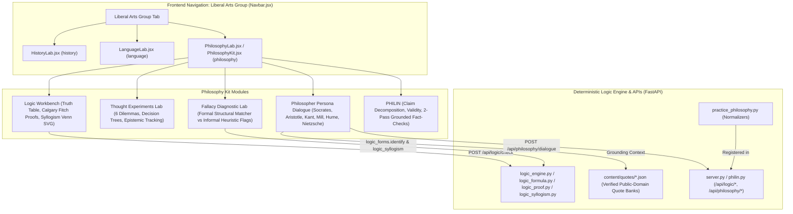

# Philosophy Kit Architecture & Liberal Arts Workspaces Revision Blueprint

## Executive Summary

This specification establishes the full **Philosophy Kit** (`PhilosophyKit.jsx` / `PhilosophyLab.jsx`) and systematically upgrades all three workspaces in the **Liberal Arts** suite (`history`, `language`, `philosophy`). 

It provides an end-to-end, file-by-file blueprint for `coder`, complete with data schemas, state machines, deterministic logic verification hooks, quote bank integrations, and cross-subject synergy mechanisms.

---

## 1. System Map & Liberal Arts Boundary



---

## 2. Philosophy Kit Specification

### 2.1 Component Hierarchy & Layout (`PhilosophyKit.jsx` / `PhilosophyLab.jsx`)

The Philosophy workspace is structured into six dedicated tools:
1. `workbench`: Interactive Logic Workbench (Truth Tables, Calgary Fitch Natural Deduction, Categorical Syllogism Venn/Euler diagrams).
2. `experiments`: Thought Experiments Lab (Trolley Problem, Ship of Theseus, Chinese Room, Experience Machine, Brain in a Vat, Veil of Ignorance).
3. `fallacies`: Fallacy Diagnostic Lab (Formal pattern matching + informal heuristic flags).
4. `dialogue`: Persona Dialogue with verified historical philosophers.
5. `analyze`: PHILIN text-to-claim block decomposition, validity checking, and grounded fact-checking.
6. `sides`: Balanced multi-position argument synthesis and deterministic ranking.
7. `class` & `courses`: Active course lesson view and syllabus progress (when a philosophy course is active).
8. `cards`: Concept, argument, and philosopher flashcards with spaced repetition.

---

### 2.2 Logic Workbench (`src/components/philosophy/LogicWorkbench.jsx`)

The Logic Workbench contains three distinct, production-grade interactive sub-tools:

#### 2.2.1 Interactive Truth Table Simulator (`TruthTableDesk.jsx`)
- **Inputs**: Up to 3 propositional formulas (e.g. `(P -> Q) & P`, `(P | Q) <-> (~P -> Q)`). Uses standard logic notation (`~`, `&`, `|`, `->`, `<->`, `T`, `F`, `_|_`).
- **Modes**:
  1. *Simulator / Auto-Solve*: Generates complete truth table ($2^n$ rows for $n \le 4$ variables). Renders variable columns, subformula breakdown columns, and main operator column.
  2. *Interactive Step-Checker*: Blank truth cells for student entry. Instant row-by-row feedback.
  3. *Semantic Classifier*: Classifies single formula as Tautology, Contradiction, or Contingency. For two formulas, evaluates logical equivalence ($A \iff B$) and highlights counterexample rows if divergent.
- **Backend Bridge**: Directly verified via `POST /api/logic/check` with `{"op": "truth_table", "formulas": [...]}` or evaluated client-side with fallback.

#### 2.2.2 Calgary Natural Deduction Fitch Step-Checker (`NaturalDeductionDesk.jsx`)
- **Ruleset**: *forall x: Calgary* Natural Deduction (P. D. Magnus, Tim Button, Richard Zach et al., Fall 2025 edition).
  - *Basic Rules*: `PR` (Premise), `AS` (Assumption), `R` (Reiteration), `&I`, `&E`, `|I`, `|E`, `->I`, `->E`, `<->I`, `<->E`, `~I`, `~E`, `X` (Explosion / Ex Falso), `IP` (Indirect Proof).
  - *Derived Rules*: `DS` (Disjunctive Syllogism), `MT` (Modus Tollens), `DNE` (Double Negation Elimination), `LEM` (Law of Excluded Middle), `DeM` (De Morgan's Laws).
- **Interactive Fitch UI**:
  - Vertical subproof nesting bars.
  - Horizontal line separating assumptions from derived steps.
  - Controls per line: Formula input, Rule selector, Citation tokens (individual line `3` or span `2-4`), Indent (`AS`), Dedent (close subproof), Delete line.
  - Real-time line-by-line status: Green checkmark for valid derivation, red warning with exact Calgary error code (`bad_cites`, `not_in_scope`, `wrong_form`, `depends_on_error`, `not_a_premise`).
  - Pre-built Scaffolds: Modus Ponens, Modus Tollens derivation from basic rules, Reductio ad Absurdum proof, De Morgan's Law derivation.
- **Backend Contract**:
  - Request: `POST /api/logic/check` with `{"op": "proof", "premises": [...], "goal": "...", "rules": "basic"|"derived", "lines": [...]}`.
  - Response: `{"valid": bool, "complete": bool, "lines": [{"ok": bool, "code"?: str, "message"?: str}]}`.

#### 2.2.3 Categorical Syllogism Venn/Euler Diagram Generator (`SyllogismVennDesk.jsx`)
- **Coverage**: All 256 categorical syllogism forms across 4 figures (15 valid in Boolean logic; 24 valid in Aristotelian logic with existential import).
- **Selector**: Mood picker (A, E, I, O for major, minor, conclusion) + Figure picker (1 to 4). Traditional names highlighted (Barbara, Celarent, Darii, Ferio, Camestres, Cesare, Baroco, Festino, Datisi, Disamis, Bocardo, Ferison, Camenes, Dimaris, Fresison).
- **Interactive SVG 3-Circle Venn Diagram**:
  - Circles: $S$ (Minor Term, top-left), $P$ (Major Term, top-right), $M$ (Middle Term, bottom-center).
  - 7 Partitioned Regions:
    1. $R_1$: $S \wedge \neg P \wedge \neg M$
    2. $R_2$: $\neg S \wedge P \wedge \neg M$
    3. $R_3$: $\neg S \wedge \neg P \wedge M$
    4. $R_4$: $S \wedge P \wedge \neg M$
    5. $R_5$: $S \wedge \neg P \wedge M$
    6. $R_6$: $\neg S \wedge P \wedge M$
    7. $R_7$: $S \wedge P \wedge M$
  - Region Shading: Automatically shades empty regions required by universal premises ($A, E$).
  - Region Marks: Places bold 'X' in candidate existence regions for particular premises ($I, O$).
  - Aristotelian Existential Import: Marks circled 'x' on the required non-empty term specified by `needs_existence_of`.
  - Conclusion Verification Toggle: Highlights whether the conclusion's statement is already fully depicted by the premise markings.

---

### 2.3 Thought Experiments Lab (`src/components/philosophy/ThoughtExperimentsLab.jsx`)

The Thought Experiments Lab features 6 canonical philosophical dilemmas with branching decision trees, moral metrics, and epistemic consequence tracking.

#### 2.3.1 Data Specification & Dilemma Catalog (`thoughtExperimentsData.js`)

```javascript
export const THOUGHT_EXPERIMENTS = [
  {
    id: 'trolley-problem',
    title: 'The Trolley Problem',
    domain: 'Normative Ethics & Deontology',
    thinkers: ['Philippa Foot (1967)', 'Judith Jarvis Thomson (1976)'],
    summary: 'A runaway trolley hurtles toward five workers. Explore the ethical tension between utilitarian outcome maximization and deontological side-constraints.',
    metrics: [
      { id: 'utilitarian', label: 'Utilitarian Welfare', color: 'var(--brand)' },
      { id: 'deontological', label: 'Deontological Duty', color: 'var(--accent)' },
      { id: 'doubleEffect', label: 'Double Effect Alignment', color: 'var(--gold-text)' }
    ],
    rootNodeId: 'switch',
    nodes: {
      'switch': {
        title: 'Variant 1: The Switch (Spur)',
        scenario: 'A runaway trolley is speeding down a track toward five workers who cannot escape. You are standing beside a lever. If you pull it, the trolley diverts onto a side track where it will kill one worker. Do you pull the lever?',
        options: [
          {
            id: 'pull-switch',
            label: 'Pull the lever (Divert trolley)',
            rationale: 'Save 5 lives at the cost of 1; 5 net lives preserved.',
            delta: { utilitarian: +20, deontological: -10, doubleEffect: +10 },
            consequence: 'The trolley diverts. One worker dies, but five survive. Most people (approx. 85-90%) choose this option.',
            nextNodeId: 'footbridge'
          },
          {
            id: 'dont-pull-switch',
            label: 'Do not pull the lever (Allow trolley to continue)',
            rationale: 'Active killing is worse than letting die; do not initiate harm.',
            delta: { utilitarian: -20, deontological: +20, doubleEffect: -10 },
            consequence: 'You refrain from intervention. Five workers perish. You avoided initiating a new causal sequence of harm.',
            nextNodeId: 'footbridge'
          }
        ]
      },
      'footbridge': {
        title: 'Variant 2: The Footbridge (Fat Man)',
        scenario: 'You stand on a footbridge over the track next to a very heavy stranger. The only way to stop the runaway trolley from killing five workers is to push this man off the bridge onto the track. His weight will stop the trolley. Do you push him?',
        options: [
          {
            id: 'push-man',
            label: 'Push the man off the bridge',
            rationale: 'Calculus of lives is identical: 5 saved vs 1 sacrificed.',
            delta: { utilitarian: +20, deontological: -35, doubleEffect: -25 },
            consequence: 'The heavy man dies, stopping the train. The 5 survive. However, only ~10% of respondents approve of this action.',
            nextNodeId: 'loop'
          },
          {
            id: 'dont-push-man',
            label: 'Refuse to push the man',
            rationale: 'Using a human being merely as a physical means violates the Categorical Imperative.',
            delta: { utilitarian: -20, deontological: +25, doubleEffect: +15 },
            consequence: 'You honor the negative duty not to kill. The five workers die. This highlights Thomson\'s distinction between diverting a threat and redirecting/using a person as a tool.',
            nextNodeId: 'loop'
          }
        ]
      },
      'loop': {
        title: 'Variant 3: The Loop Track',
        scenario: 'The side track loops back around to the main track where the five workers stand. However, a heavy man is tied to the loop track; his body alone will stop the trolley. If you divert the train, it hits him and stops; if he were not there, diverting would loop back and kill the five anyway. Do you pull the lever?',
        options: [
          {
            id: 'pull-loop',
            label: 'Divert onto the loop',
            rationale: 'Diverting is still a mechanical switch, even though his presence is causally required to stop the train.',
            delta: { utilitarian: +15, deontological: -20, doubleEffect: -15 },
            consequence: 'Dilemma: Here the person is used as an instrument (contrary to Double Effect), yet the mechanical act is identical to the Switch.',
            nextNodeId: 'transplant'
          },
          {
            id: 'dont-pull-loop',
            label: 'Do not divert onto the loop',
            rationale: 'His body is needed as a buffer; diverting depends essentially on his death.',
            delta: { utilitarian: -15, deontological: +20, doubleEffect: +20 },
            consequence: 'You recognize that the loop variant removes the collateral/intended distinction.',
            nextNodeId: 'transplant'
          }
        ]
      },
      'transplant': {
        title: 'Variant 4: The Transplant Surgeon',
        scenario: 'You are a brilliant surgeon. Five patients are dying of organ failure (heart, lungs, liver, kidneys). A healthy traveler arrives for a routine checkup. If you secretly euthanize him and harvest his organs, all five patients will survive. Do you harvest the organs?',
        options: [
          {
            id: 'harvest-organs',
            label: 'Harvest the organs secretly',
            rationale: 'Maximizes survival (5 lives vs 1 life).',
            delta: { utilitarian: +10, deontological: -50, doubleEffect: -40 },
            consequence: 'Extremely few ethicists endorse this. Demonstrates that naive act utilitarianism collapses without institutional rights constraints.',
            nextNodeId: 'summary'
          },
          {
            id: 'refuse-harvest',
            label: 'Refuse to harvest organs',
            rationale: 'Absolute taboo against violating innocent bodily integrity.',
            delta: { utilitarian: -10, deontological: +40, doubleEffect: +30 },
            consequence: 'You uphold medical deontological ethics. The 5 patients die of natural illness.',
            nextNodeId: 'summary'
          }
        ]
      }
    }
  },
  {
    id: 'ship-of-theseus',
    title: 'The Ship of Theseus',
    domain: 'Metaphysics & Identity Over Time',
    thinkers: ['Plutarch', 'Thomas Hobbes (1655)'],
    summary: 'As planks rot, they are replaced one by one. Later, the old planks are reassembled into a second ship. Which ship is the original?',
    metrics: [
      { id: 'spatioTemporal', label: 'Continuous History', color: 'var(--brand)' },
      { id: 'material', label: 'Material Composition', color: 'var(--gold-text)' },
      { id: 'functional', label: 'Functional Continuity', color: 'var(--accent)' }
    ],
    rootNodeId: 'replacement',
    nodes: { /* ... */ }
  },
  {
    id: 'chinese-room',
    title: 'The Chinese Room Argument',
    domain: 'Philosophy of Mind & Artificial Intelligence',
    thinkers: ['John Searle (1980)'],
    summary: 'A person inside a room follows English syntactic rules to manipulate Chinese characters without understanding a word. Does syntactic manipulation equal genuine semantic understanding?',
    metrics: [
      { id: 'functionalism', label: 'Computational Functionalism', color: 'var(--brand)' },
      { id: 'intentionality', label: 'Biological Intentionality', color: 'var(--accent)' }
    ],
    rootNodeId: 'room_setup',
    nodes: { /* ... */ }
  },
  {
    id: 'experience-machine',
    title: 'The Experience Machine',
    domain: 'Axiology & Well-Being',
    thinkers: ['Robert Nozick (1974)'],
    summary: 'A machine can stimulate your brain to experience any pleasurable life you desire, indistinguishable from reality. Would you permanently plug in?',
    metrics: [
      { id: 'hedonism', label: 'Hedonistic Well-Being', color: 'var(--brand)' },
      { id: 'authenticity', label: 'Contact with Reality', color: 'var(--accent)' }
    ],
    rootNodeId: 'plug_in',
    nodes: { /* ... */ }
  },
  {
    id: 'brain-in-a-vat',
    title: 'The Brain in a Vat',
    domain: 'Epistemology & Skepticism',
    thinkers: ['René Descartes (1641)', 'Hilary Putnam (1981)'],
    summary: 'Could you be a disembodied brain in a vat stimulated by a mad scientist? Can you prove you are not?',
    metrics: [
      { id: 'skepticism', label: 'Skeptical Uncertainty', color: 'var(--brand)' },
      { id: 'externalism', label: 'Semantic Externalism', color: 'var(--accent)' }
    ],
    rootNodeId: 'skeptical_doubt',
    nodes: { /* ... */ }
  },
  {
    id: 'veil-of-ignorance',
    title: 'The Veil of Ignorance',
    domain: 'Political Philosophy & Distributive Justice',
    thinkers: ['John Rawls (1971)'],
    summary: 'Design the basic structure of society without knowing your wealth, race, natural talents, or social status. What principles of justice would rational agents choose?',
    metrics: [
      { id: 'maximin', label: 'Maximin / Difference Principle', color: 'var(--brand)' },
      { id: 'libertarian', label: 'Libertarian Entitlement', color: 'var(--accent)' },
      { id: 'utilitarian', label: 'Average Utility Maximization', color: 'var(--gold-text)' }
    ],
    rootNodeId: 'original_position',
    nodes: { /* ... */ }
  }
];
```

#### 2.3.2 Epistemic Consequence Tracking & Philosopher Synthesis
- **State Store**: Persists path taken, cumulative framework metrics, and choice rationales.
- **Dynamic Synthesis Report**:
  - Highlights moral/epistemic contradictions (e.g. Thomson's paradox: pulling Switch lever vs refusing Footbridge push).
  - Aligns student profile with historical schools:
    - Utilitarianism (Bentham, Mill)
    - Deontology (Kant)
    - Virtue Ethics (Aristotle)
    - Contractarian Justice (Rawls)
    - Skeptical Empiricism (Hume)

---

### 2.4 Fallacy Diagnostic Lab (`src/components/philosophy/FallacyLab.jsx`)

Provides dual-engine diagnostic analysis of philosophical argumentation:

#### 2.4.1 Formal Fallacy Engine (Deterministic Proof of Invalidity)
Matched with 100% mathematical certainty against `logic_forms.identify` and `logic_syllogism.py`:
1. **Affirming the Consequent**: Premise 1: $P \to Q$, Premise 2: $Q \implies$ Conclusion: $P$.
   - Counterexample row: $P = \text{False}, Q = \text{True}$.
2. **Denying the Antecedent**: Premise 1: $P \to Q$, Premise 2: $\neg P \implies$ Conclusion: $\neg Q$.
   - Counterexample row: $P = \text{False}, Q = \text{True}$.
3. **Affirming an Alternative**: Premise 1: $P \vee Q$, Premise 2: $P \implies$ Conclusion: $\neg Q$ (invalid under inclusive $\vee$).
4. **Undistributed Middle**: The middle term $M$ in a syllogism is not distributed in either premise.
5. **Illicit Major / Illicit Minor**: Term distributed in the conclusion without being distributed in its corresponding premise.
6. **Fallacy of Exclusive Premises**: Both premises are negative ($E$ or $O$).
7. **Existential Fallacy**: Deriving a particular conclusion ($I, O$) from two universal premises ($A, E$) without existential presupposition.

#### 2.4.2 Informal Fallacy Diagnostic Engine (Non-Dogmatic Heuristic Flags)
Treats informal fallacies as dialectical risks rather than absolute syntactic errors, explaining when the form may be legitimate:
1. **Ad Hominem (Abusive, Tu Quoque, Circumstantial)**: Attacking the proponent rather than the claim. *Legitimate boundary*: Cross-examining witness honesty or financial conflict of interest in testimony.
2. **Straw Man**: Distorting an opponent's position into an extreme, easily refuted caricature. *Remedy*: Apply the Principle of Charity (reconstruct the strongest version).
3. **Slippery Slope**: Asserting a catastrophic chain of events ($A \to B \to C \to Z$) without demonstrating the causal necessity of each link. *Legitimate boundary*: Demonstrating proven empirical precedent or positive feedback loops.
4. **Begging the Question (Petitio Principii / Circularity)**: Assuming the truth of the conclusion in a premise. Verified via `logic_argmap.check_map`.
5. **False Dilemma (Excluded Middle Fallacy)**: Restricting options to two extremes while ignoring intermediate alternatives.
6. **Appeal to Inappropriate Authority (Ad Verecundiam)**: Citing an authority whose expertise lies outside the domain under debate or where no scholarly consensus exists.
7. **Equivocation**: Shifting between two meanings of a single word across premises.
8. **Post Hoc Ergo Propter Hoc**: Confusing temporal sequence ("after this") with causal consequence ("because of this").

---

### 2.5 Philosophical Persona Dialogue (`src/components/philosophy/PhilosopherDialogue.jsx`)

Enables real-time Socratic dialogue with six historical philosophical figures, strictly grounded in verified public-domain quote banks in `content/quotes/*.json`:
1. **Socrates** (`content/quotes/socrates.json`): Plato's *Apology*, *Crito*, *Meno*, *Republic* (trans. Benjamin Jowett, 1871). Method: Socratic elenchus, questioning unexamined assumptions, aporia.
2. **Aristotle** (`content/quotes/aristotle.json`): *Nicomachean Ethics*, *Politics* (trans. F. H. Peters 1893, Benjamin Jowett 1885). Method: Teleology, virtue as the golden mean, practical wisdom (*phronesis*).
3. **Immanuel Kant** (`content/quotes/kant.json`): *Groundwork of the Metaphysics of Morals*, *Critique of Pure Reason* (trans. Thomas Kingsmill Abbott 1895, J. M. D. Meiklejohn 1855). Method: Categorical imperative tests, duties as universal laws, autonomy vs heteronomy.
4. **John Stuart Mill** (`content/quotes/mill.json`): *Utilitarianism*, *On Liberty* (1861, 1859). Method: Greatest Happiness Principle, qualitative pleasures, the Harm Principle boundary.
5. **David Hume** (`content/quotes/hume.json`): *An Enquiry Concerning Human Understanding*, *Treatise of Human Nature* (1748, 1739). Method: Empiricist fork, skepticism regarding causation, Hume's is-ought guillotine.
6. **Friedrich Nietzsche** (`content/quotes/nietzsche.json`): *Beyond Good and Evil*, *Thus Spoke Zarathustra* (trans. Helen Zimmern 1906, Thomas Common 1909). Method: Genealogy of morals, master vs slave morality, will to power.

#### Backend Contract (`POST /api/philosophy/dialogue`):
```json
{
  "figure": "socrates",
  "message": "Is justice simply the advantage of the stronger?",
  "history": [
    { "role": "assistant", "content": "Welcome, my friend. Tell me, what do you hold justice to be?" }
  ]
}
```
**Response**:
```json
{
  "reply": "You speak as Thrasymachus once spoke in the house of Cephalus! But consider: if a ruler commands what is harmful to himself, is it just for the subjects to obey?",
  "quote": {
    "id": "apology-38a",
    "text": "the unexamined life is not worth living",
    "work": "Plato, Apology",
    "ref": "38a"
  },
  "suggested_questions": [
    "Does a doctor practice medicine for his own advantage or for the patient?",
    "Can a ruler make mistakes about what is truly advantageous?"
  ]
}
```

---

## 3. Revisions to Existing Liberal Arts Workspaces

### 3.1 History Workspace Revision (`HistoryLab.jsx`)
1. **Interactive Offline Map Pins**:
   - Resolve pin coordinate overlap with concentric circular spiderfication when pins share coordinates.
   - Embed default historical geopolitical anchor markers (Athens, Rome, Alexandria, Jerusalem, Constantinople, London, Paris, Chang'an, Tenochtitlan) so maps are immediately informative prior to course enrollment.
   - Smooth SVG viewBox animation when switching map regions (`world`, `europe`, `mediterranean`, `americas`, `asia`).
2. **Primary Source Interrogator (SHEG Analytical Framework)**:
   - Structure `PrimarySourceLab.jsx` with the 4 Stanford History Education Group pillars:
     1. *Sourcing*: Author background, purpose, perspective, reliability.
     2. *Contextualization*: Historical climate, contemporaneous events, social constraints.
     3. *Corroboration*: Cross-referencing against auxiliary historical documents.
     4. *Close Reading*: Rhetorical devices, loaded vocabulary, argument structure.
3. **Timeline Scoping & Gestural Performance**:
   - Provide scoping toggles: "All Topics", "Active Course Only", or "Era Band" (e.g. Antiquity, Medieval, Early Modern, 20th Century).
   - Smooth horizontal pan/zoom acceleration for wheel and touch interactions in `HistoryTimeline.jsx`.
4. **Historical Figures Persona Roster**:
   - Expand `FiguresTab` to offer immediate conversational access to foundational historical figures (Pericles, Julius Caesar, Queen Elizabeth I, Abraham Lincoln, Winston Churchill) backed by `PERSONA_PROMPT` in `server.py`.

### 3.2 Languages Workspace Revision (`LanguageLab.jsx`)
1. **Practice Hub Expansion**:
   - Integrate `minimal_pairs` and `dictation` as first-class interactive drills in `LanguageLab.jsx` practice options.
   - Dedicated Conjugation Desk (`conjugate`) with verb stem analysis, irregular inflection markers, and tense selector (Present, Past, Future, Subjunctive).
   - Interactive IPA Reference Matrix (`PronounceTab.jsx`): clickable phonetic symbols with audio playback of canonical target sounds.
2. **Vocabulary Strength & Decay Algorithm**:
   - Dynamic strength indicator (0 to 4 bars) with time-based memory decay:
     - 4 bars (Mastered): Successfully reviewed $\ge 4$ times across $\ge 14$ days.
     - 3 bars (Strong): Reviewed within 7 days.
     - 2 bars (Learning): Reviewed within 3 days.
     - 1 bar (Needs Review): Unreviewed $> 7$ days.
   - Color tokens: Grey (0), Caslon Gold (1-2), Griffin Green (3), Brand Accent (4).
3. **TTS Pipeline Resilience**:
   - Seamless two-tier synthesis: High-fidelity ElevenLabs neural voice (when `SCIEDU_ELEVENLABS=1` and server key active) with instantaneous fallback to browser `speechSynthesis`.
   - Audio prefetching pipeline (`prefetchAudio`) for upcoming exercise prompts to ensure zero-latency practice flow.

### 3.3 Cross-Discipline Synergy under "Liberal Arts" Navbar Group
1. **Unified Workspace Routing**:
   - Update `server.py`: add `"philosophy"` to `WORKSPACES = ("math", "code", "lab", "history", "language", "philosophy")`.
   - Update `server.guess_workspace` with `_PHIL_RE` pattern matching (`philosoph|logic|ethics|epistemolog|metaphysic|moral|fallac|argument|syllogism`).
   - Update `src/components/SubjectWorkspace.jsx` to render `PhilosophyLab` when `kind === 'philosophy'`, passing full `classTopic`, `topics`, `onOpenTopic`, and `renderClass` props.
2. **Cross-Disciplinary Spaced Review**:
   - Unified review queue (`/api/review/{user}/session`) interleaving missed questions from History, Languages, and Philosophy.
3. **Intertextual Linking**:
   - Direct link between History primary sources (e.g. Trial of Socrates in 399 BCE Athens), Philosophy persona dialogue (Socrates in `Apology`), and Language Greek vocabulary.

---

## 4. Concrete Task Blueprint for Claude (`coder`)

### Task 1: Backend Philosophy Layer 2 Practice Normalizers & Logic API
- **Files to create/modify**:
  - `practice_philosophy.py` (New): Implement `NORMALIZERS = {"truth_table": ..., "validity": ..., "syllogism": ..., "proof_steps": ..., "argument_map": ..., "spot_parts": ..., "fallacy_id": ...}` with docstrings for `/api/practice/guide`.
  - `server.py`:
    - Add `"philosophy"` to `WORKSPACES` (line 6034).
    - Add `_PHIL_RE` to `guess_workspace` (line 6043).
    - Import `practice_philosophy` and merge into `PRACTICE_NORMALIZERS` and `PRACTICE_TYPES`.
    - Expose `POST /api/logic/check` (proxying `logic_engine.check`) and `GET /api/logic/guide`.
    - Expose `POST /api/philosophy/dialogue` for philosophical figure persona chat.
  - `mcp_tools_philosophy.py` (New): Authoring MCP tools (`add_truth_table`, `add_syllogism`, `add_proof`, `add_argument_map`, `add_fallacy_item`).
- **Verification**:
  - `python3 -m unittest discover -s tests -p "test_logic*.py"` passes.
  - Unit tests in `tests/test_philosophy_practice.py` validating normalization of all 7 types.

### Task 2: Verified Public-Domain Philosophical Quote Banks
- **Files to create**:
  - `content/quotes/aristotle.json`
  - `content/quotes/kant.json`
  - `content/quotes/mill.json`
  - `content/quotes/hume.json`
  - `content/quotes/nietzsche.json`
- **Schema Compliance**:
  - Every quote: `{"id", "author", "work", "ref", "translator", "year", "text", "partial", "tags", "source_url", "pd"}`.
  - Length $\le 200$ chars, `pd: true`, valid `https://` source url on Gutenberg / MIT Classics.
- **Verification**:
  - `python3 -m unittest discover -s tests -p "test_quotes.py"` runs and passes 100%.

### Task 3: Philosophy Kit Frontend Architecture
- **Files to create/modify**:
  - `src/components/PhilosophyLab.jsx`: Expand tabs to `['class', 'courses', 'workbench', 'experiments', 'fallacies', 'dialogue', 'analyze', 'sides', 'cards']`.
  - `src/components/SubjectWorkspace.jsx`: Add support for `props.kind === 'philosophy'`.
  - `src/App.jsx`: Update mode routing so philosophy uses `SubjectWorkspace` and receives `classTopic`, `topics`, `onOpenTopic`, `renderClass`.

### Task 4: Interactive Logic Workbench Componentry
- **Files to create**:
  - `src/components/philosophy/LogicWorkbench.jsx`: Master container with tab toggle between Truth Table, Fitch Proof, and Syllogism Venn.
  - `src/components/philosophy/TruthTableDesk.jsx`: Formula parser, truth table matrix, classification badges.
  - `src/components/philosophy/NaturalDeductionDesk.jsx`: Interactive Fitch table, line addition, indentation, live Calgary rule validation.
  - `src/components/philosophy/SyllogismVennDesk.jsx`: Mood/Figure selector, 3-circle SVG Venn diagram with region shading and 'X' placement.

### Task 5: Thought Experiments Lab Componentry
- **Files to create**:
  - `src/components/philosophy/thoughtExperimentsData.js`: 6 dilemma trees with decision nodes, metrics deltas, and philosophical consequences.
  - `src/components/philosophy/ThoughtExperimentsLab.jsx`: Interactive decision desk, dynamic metric gauge bars, choice trail, and philosopher synthesis comparison.

### Task 6: Fallacy Diagnostic Lab Componentry
- **Files to create**:
  - `src/components/philosophy/FallacyLab.jsx`: Formal structural scanner + informal heuristic flag analyzer with interactive repair exercises.

### Task 7: Philosophical Figures Persona Dialogue Componentry
- **Files to create**:
  - `src/components/philosophy/PhilosopherDialogue.jsx`: Chat interface with philosopher selector (Socrates, Aristotle, Kant, Mill, Hume, Nietzsche), quote citation badges, and Socratic challenge prompts.

### Task 8: History Workspace Revisions
- **Files to modify**:
  - `src/components/history/OutlineMap.jsx` & `HistoryTabs.jsx` (`MapTab`): Implement pin spiderfication for overlapping coordinates and default regional anchors.
  - `src/components/PrimarySourceLab.jsx`: Embed SHEG framework tabs (Sourcing, Context, Corroboration, Close Reading).
  - `src/components/history/HistoryTimeline.jsx`: Add Era filtering and smooth drag acceleration.

### Task 9: Languages Workspace Revisions
- **Files to modify**:
  - `src/components/LanguageLab.jsx`: Add Minimal Pairs and Dictation drill launching in Practice Hub.
  - `src/components/language/LanguageExtraTabs.jsx`: Add interactive Conjugation Desk.
  - `src/lib/speech.js` & `LanguageLab.jsx`: Add vocabulary decay algorithm and visual strength meter updates.

### Task 10: Liberal Arts Cross-Discipline Synergy & Styling
- **Files to modify**:
  - `src/styles/lab.css`: Add styling for Fitch proof bars, Venn diagrams, thought experiment gauges, and fallacy badges.
  - `src/practice/registry.js`: Register `src/practice/philosophy.jsx`.
