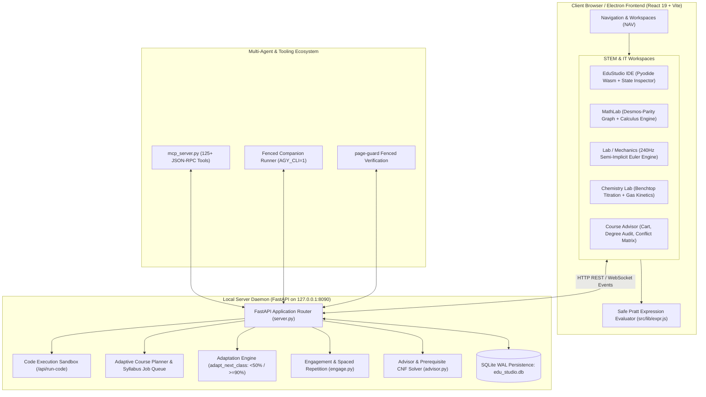
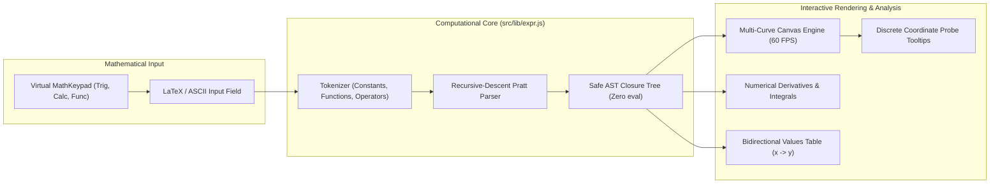
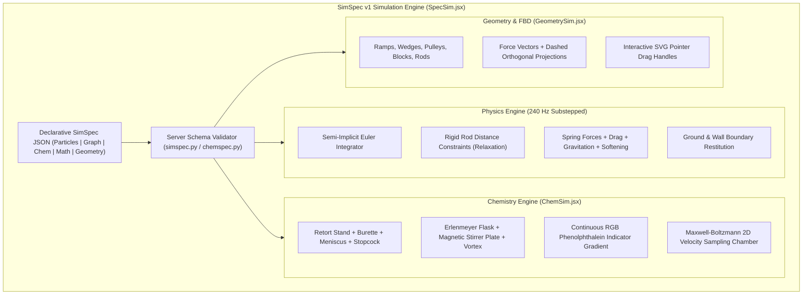
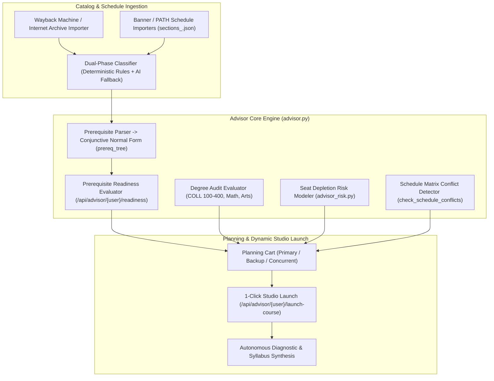
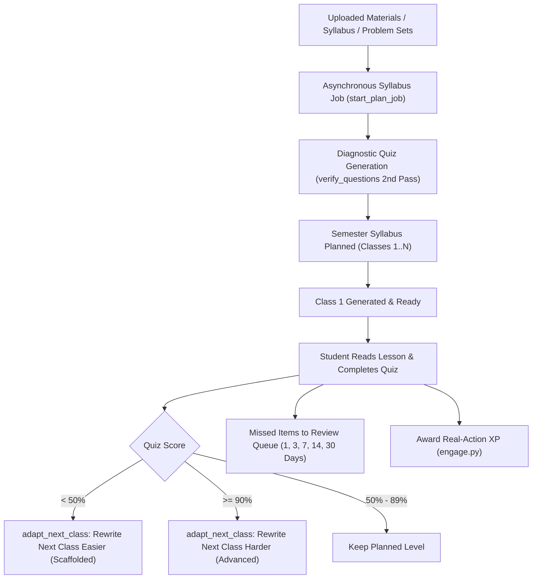

# Scientific Computing, IT & Educational Infrastructure Ecosystem

## Executive Summary & System Overview

**&.edu (SciEdu-Studio)** is a locally executed, autonomous academic operating environment designed for deep STEM mastery, computer science education, laboratory experimentation, and university-level curriculum planning.

Unlike conventional learning management systems (LMS) or static online courseware, &.edu functions as an **adaptive, reactive cognitive engine**. It ingests arbitrary raw academic materials (textbooks, problem sets, lecture slides, research papers, syllabus PDFs), conducts an initial diagnostic assessment, and dynamically synthesizes an individualized, adaptive sequence of university-grade classes. Each class contains an interactive derivation with LaTeX typography, declarative laboratory simulations, multi-modal practice problems, and Socratic automated tutoring.

The system is engineered under strict architectural constraints:
1. **Loopback Isolation & Zero-Trust Security**: The backend daemon (`server.py`) binds strictly to `127.0.0.1:8090`. All code execution, database transactions, and model interactions occur within process boundaries or sandboxed runtimes.
2. **Deterministic Evaluation & Non-Normative Verifiability**: All mathematical calculations, code assertions, logic validations, and grading engines execute via standard-library algorithms or sandboxed WebAssembly interpreters with zero reliance on stochastic LLM grading.
3. **Dual Execution Runtime**: Code and mathematical scripts execute either client-side via **Pyodide WebAssembly** for instantaneous offline responsiveness or server-side via restricted sub-processes with resource cgroups and timeout bounds.
4. **Autonomous Agent Headless Control**: Through a zero-dependency **Model Context Protocol (MCP)** server exposing 125+ specialized tools, external AI agents (Antigravity CLI `agy`, Claude Code, Cursor) can programmatically author curricula, debug code, manipulate simulations, and drive the student's graphical interface in real time.



---

## 1. Computer Science & IT Infrastructure (EduStudio IDE)

The IT workspace (`src/components/EduStudioIDE.jsx`) is a specialized software engineering laboratory designed for algorithms, systems programming, and computer science pedagogy.

### 1.1 Dual-Tier Code Execution Engine

EduStudio IDE provides a hybrid execution architecture balancing sub-millisecond local latency with server-side sandboxed reliability:

1. **Client-Side WebAssembly Runtime (Pyodide)**:
   - For interactive Python exercises, introductory algorithms, and data structure manipulation, the browser initializes a Pyodide WebAssembly virtual machine.
   - **Post-Execution State Introspection**: The client runtime interrogates the Pyodide global namespace following execution. It extracts local variables, primitive values, data types, list lengths, and nested dictionary structures without serializing heavy objects.
   - **Memory & Call-Stack Visualizer**: Global and local frames are projected into a visual memory grid, displaying pointers, references, and mutation states across iteration steps.
2. **Server-Side Sandboxed Process Runner (`POST /api/run-code`)**:
   - For multi-file execution, heavy computation, or non-Python runtimes (JavaScript/TypeScript, C++, Rust, SQL), execution dispatches to the server.
   - **Process Isolation**: Commands execute inside an isolated subprocess with stripped environment variables (`PATH` restricted to system binaries, `HOME` directed to a temporary scratchpad, `network` denied).
   - **Resource Quotas**: Hard CPU execution timeouts (default 5.0 seconds) and memory allocation caps prevent infinite loops and fork bombs.
   - **Standard I/O Multiplexing**: Captured `stdout`, `stderr`, and exit status codes stream back over structured JSON.

### 1.2 Automated Problem Sprints & Answer Scrubbing (`sprint.py`)

For focused algorithmic training and homework problem sets, the system implements **Problem Sprints**:
- **Zero Answer Leakage**: Problem steps, test assertions, and reference solutions live exclusively in database class metadata (`classes.meta.sprint`). They are strictly scrubbed from all topic JSON serializers, preventing client-side DevTools inspection.
- **Socratic Step Revelation (`POST /api/courses/{id}/classes/{seq}/reveal`)**: Students receive problem context and starter code. Hints and sequential problem sub-parts are revealed strictly one step at a time upon explicit request or failed attempts.
- **Deterministic Assertion Checking (`POST /api/courses/{id}/classes/{seq}/check`)**: Code submissions are validated against a hidden unit test harness. The grader returns per-test pass/fail status, expected versus actual return values, and execution timings.
- **Soft-Clear Retention**: Completing a sprint transitions the course to `status: cleared`. If not actively retained by the student via `/keep`, ephemeral sprint data is automatically purged after `SCIEDU_SPRINT_RETAIN_DAYS` (default 7 days).

### 1.3 Socratic Code Diagnostics & Traceback Translation

When a student's code raises an unhandled exception or fails an assertion, the IDE avoids dumping raw cryptic tracebacks:
- The system intercepts the traceback and extracts the exception type, frame depth, and line offset.
- An automated diagnostic analyzer classifies common cognitive blockers:
  - Off-by-one errors in loop boundaries (`IndexError: list index out of range`).
  - Mutable default arguments in function definitions.
  - Variable shadowing across local and outer scopes.
  - Recursion depth exhaustion (missing base case).
  - Unhandled `NoneType` attribute access (`AttributeError`).
- The diagnostic engine presents a concise, 2-to-3 sentence Socratic diagnostic hint guiding the student to re-examine the invariant without spoiling the solution.

---

## 2. Advanced Mathematical Computing & Analysis (MathLab)

MathLab (`src/components/MathLab.jsx`) provides a professional-grade mathematical computing workbench offering full analytical parity with Desmos, Wolfram Alpha, and Jupyter.



### 2.1 Desmos-Parity Mathematical Grammar (`src/lib/expr.js` & `server.py:safe_arith`)

Both client-side rendering and server-side verification share a unified mathematical evaluation grammar:
- **Zero `eval()` Security Invariant**: JavaScript `eval()` and `new Function()` are strictly forbidden. Mathematical strings parse via a deterministic **recursive-descent Pratt parser** directly into safe closure trees. On the server, expressions undergo AST node allowlisting via Python's `ast.parse`.
- **Exhaustive Function Support**:
  - **Trigonometric & Hyperbolic**: Direct (`sin`, `cos`, `tan`, `sinh`, `cosh`, `tanh`), Reciprocal (`csc`, `sec`, `cot`, `csch`, `sech`, `coth`), Inverse (`asin`, `acos`, `atan`, `atan2`, `asinh`, `acosh`, `atanh`), and Reciprocal Inverse (`acsc`, `asec`, `acot`, `acsch`, `asech`, `acoth`).
  - **Calculus & Special Functions**: Error function `erf(x)` via Chebyshev approximations, Gamma function $\Gamma(x)$ via Lanczos approximation, unnormalized `sinc(x)`, Heaviside step `step(x)`, and rectangular pulse `rect(x)`.
  - **Combinatorics & Discrete Math**: Exact factorial `fact(n)` (cached up to 170, falling back to $\Gamma(n+1)$), permutations `nPr(n, r)`, combinations `nCr(n, r)`, greatest common divisor `gcd(a, b)`, and least common multiple `lcm(a, b)`.
  - **Real Roots & Logarithms**: Real odd roots `nthroot(x, n)` supporting $x < 0$, natural log `ln(x)`, binary log `log2(x)`, common log `log10(x)`, and arbitrary-base logarithm `log(x, [b])`.

### 2.2 Interactive Numerical Calculus & Graph Engine

The graphing canvas (`GraphTab`) features real-time numerical analysis:
- **Discontinuity & Asymptote Detection**: Scans consecutive sample points for sign inversions across vertical poles (e.g. $\tan x$ at $\frac{\pi}{2}$), suppressing spurious vertical connector lines.
- **Numerical Derivative Curve $f'(x)$**: Evaluates central difference quotients $f'(x) \approx \frac{f(x + h) - f(x - h)}{2h}$ with adaptive step size $h = 10^{-5}$, displaying tangent cursor lines that track cursor coordinates.
- **Definite Integration $\int_a^b f(x)\,dx$**: Computes numerical quadrature via Simpson's composite rule with dynamic visual trapezoid/parabolic fills between limits $a$ and $b$.
- **Critical Points & Root Finder**: Identifies local extrema (maxima/minima) and roots via combined bisection and Newton-Raphson iterations, flagging points on the canvas with coordinate badges.
- **MathKeypad Integration**: Multi-tab on-screen keypad (`123` basic algebra, `Trig` trigonometric/hyperbolic, `Func` calculus/special functions) with `onMouseDown={e => e.preventDefault()}` non-blurring focus preservation.

### 2.3 Procedural Math Problem Verification (`/api/math/practice`)

When generating algorithmic math practice:
- The generator produces a problem prompt, LaTeX worked steps, and an explicit `compute` expression (e.g. `"compute": "sqrt(2)*3 + 1/4"`).
- The server evaluates `compute` deterministically via `safe_arith`.
- Stated answers deviating from the computed ground truth by more than $0.5\%$ or $10^{-9}$ are dropped instantly. Mismatched or hallucinated model answers are eliminated before reaching the student.

---

## 3. Virtual Laboratory & Scientific Simulation Suite

The Laboratory workspace (`src/simulations/` and `src/components/TopicViewer.jsx`) executes physical, chemical, and biological apparatuses matching real benchtop experimental setups.



### 3.1 240 Hz Substepped Physics Simulation (`SpecSim.jsx`)

Declarative `kind: "particles"` and `kind: "graph"` simulations evaluate physical dynamics without external game engines:
- **Substepped Semi-Implicit Euler Integration**: Operates at 240 Hz (4 sub-steps per 60 Hz visual animation frame) to eliminate numerical energy explosion and integration drift in stiff differential systems.
- **Distance Constraints (Relaxation Algorithm)**: Enforces rigid rod links (e.g. double pendulums, linkages) using iterative position-based constraint relaxation.
- **Mutual Gravitational Fields**: Simulates $N$-body celestial orbital dynamics using Newton's law with Plummer softening ($\epsilon = 2.0$) to prevent infinite acceleration singularities on close encounters:
  $$\mathbf{F}_{ij} = G \frac{m_i m_j}{(r_{ij}^2 + \epsilon^2)^{3/2}} \mathbf{r}_{ij}$$
- **Harmonic Springs & Damping**: Evaluates Hooke's law $\mathbf{F}_s = -k (\|\mathbf{x}\| - L_0) \hat{\mathbf{x}}$ coupled with velocity-dependent viscous damping $\mathbf{F}_d = -c \mathbf{v}$.
- **Live Vector & Chart Projections**: Real-time rendering of instantaneous velocity/acceleration vectors and rolling series strip-charts (energy conservation $E = K + U$ over time).

### 3.2 Benchtop Chemistry Simulation Kit (`ChemSim.jsx` & `chemspec.py`)

Matches physical glassware apparatuses for quantitative titration and kinetic chemistry:
1. **Titration Benchtop Apparatus**:
   - Retort stand with chrome support upright and dual-finger screw clamp.
   - Precision graduated burette featuring a fluid meniscus line, volume gradations (0.1 mL resolution), and an interactive rotating stopcock valve.
   - Gravitational droplet emitter modeling surface tension detachment and fluid splash dynamics upon liquid contact.
   - Erlenmeyer reaction flask with rising fluid volume, porcelain magnetic stirrer plate, rotating Teflon stir bar, and fluid vortex depression.
   - Benchtop digital pH meter with dip electrode probe and 2-decimal digital readout.
   - Continuous colorimetric gradient modeling indicator equilibria (e.g. colorless to deep fuchsia for phenolphthalein between pH 8.2 and 10.0) with fluid swirl eddies.
2. **Molecular Kinetics & Gas Law Chamber**:
   - Maxwell-Boltzmann 2D thermal velocity distribution sampling:
     $$f(v) \propto v \exp\left(-\frac{m v^2}{2 k_B T}\right)$$
   - Wall-momentum impulse counters calculating live macroscopic pressure against analog dial pressure gauges.
   - Activation energy thresholding: Reactive collisions exceeding $E_a$ trigger chemical synthesis accompanied by visual optical flashes.

### 3.3 Visual Geometry & Free-Body Diagram Apparatus (`GeometrySim.jsx`)

Provides declarative mechanics diagrams (`kind: "geometry"` / `kind: "fbd"`):
- **Physical Apparatus Shapes**: Inclined planes, wedges, pulleys, mass blocks, rigid rods, and wall boundaries.
- **Force Vector Projections**: Force vectors declare origins, magnitudes, and angles. When `projections: true` is active, the engine renders dashed orthogonal components ($F_\parallel, F_\perp$ or $F_x, F_y$).
- **Direct SVG Drag Handles**: Force vector arrowheads and block bodies feature direct SVG pointer drag handles. Students can drag force vectors or tilt ramps interactively, updating reactive parameters and equations live.
- **Embedded Notes Compilation**: Lesson markdown blocks marked ````geometry` compile inline via `GeometrySim`, allowing notes to contain interactive interactive diagrams.

### 3.4 Multi-Modal Vision Diagram Grading (`/api/draw/check`)

For spatial and visual STEM tasks (e.g. "Draw the Free-Body Diagram of a block on a rough incline"):
- The UI exposes an interactive drawing canvas (`draw` practice type) supporting grid, axes, or blank canvases.
- Student drawings are rasterized to base64 PNG images and posted to `/api/draw/check`.
- A Gemini vision model evaluates the drawing against explicit pedagogical criteria (e.g. `["Normal force perpendicular to ramp", "Friction directed up the incline", "Gravity straight down"]`).
- The grader returns a deterministic per-criterion pass/fail breakdown and targeted corrective drawing guidance.

---

## 4. Academic Advisor & Institutional Curriculum Engine

The Advisor ecosystem (`advisor.py`, `advisor_cart.py`, `advisor_risk.py`, `advisor_classifier.py`, `wm_advising.py`) bridges classroom learning with real-world university degree navigation, grounded in official William & Mary course catalog and schedule data.



### 4.1 Prerequisite Conjunctive Normal Form (CNF) Engine

Course prerequisites are parsed into strict Conjunctive Normal Form: an **AND of OR-choice groups** (`List[List[str]]`):
- For example, `CSCI 241` requires `"CSCI 141 and (MATH 111 or MATH 131)"`, which parses to:
  $$\text{prereq\_tree} = [[\text{"CSCI 141"}], [\text{"MATH 111"}, \text{"MATH 131"}]$$
- **Satisfaction Rule**: The engine verifies that the student's completed course record contains at least one passing grade for each inner OR-clause.
- **Per-Section Rule Differentiation**: Sections of the same course can have divergent prerequisites (e.g. `DATA 440-01` requiring `DATA 301` vs `DATA 440-02` requiring `DATA 201`). When queried with a section CRN, the engine inspects the section's explicit PATH restrictions line, overriding the general catalog rule when appropriate.
- **Concurrent Fulfillment Modeling**: Courses flagged with `* May be taken concurrently` are tracked. If a prerequisite code is currently present in the student's primary registration cart for the target semester, the readiness check evaluates as satisfied via concurrent enrollment.

### 4.2 Degree Audit & Curriculum Framework

The degree audit engine evaluates progress against the William & Mary College Curriculum (COLL):
- **COLL 100**: Big Ideas (4 credits).
- **COLL 150**: First-Year Seminar with writing emphasis (4 credits).
- **COLL 200**: Exploring Foundations (12 credits across Arts, Letters & Values [ALV], Cultures, Societies & Individuals [CSI], and Natural & Quantitative Reasoning [NQR]).
- **COLL 300**: In the World / Cross-Cultural & Global Experience (3 credits).
- **COLL 400**: Capstone Experience in the Major (3 credits).
- **Proficiencies**: Mathematics and Creative & Performing Arts.
- **Non-Hallucination Integrity Guard**: Departmental 300-level courses (`MATH 300`, `ECON 300`, `BUAD 300`) are standard junior courses and are **never** automatically classified as COLL 300. Only courses carrying official institutional global attributes or verified COLL prefixes satisfy the requirement.

### 4.3 Registration Cart Risk Modeling & Conflict Matrix

The planning cart (`advisor_cart.py`) provides intelligent semester schedule construction:
- **Historical Seat Depletion Risk (`advisor_risk.py`)**: Computes registration seat loss probability based on historical fill rates, class year seniority, and section seat capacity, categorizing risk as `low`, `medium`, or `high`.
- **Optimal Registration Sequence**: Recommends the exact order in which CRNs should be submitted during open registration: prioritizing high-risk required courses first, followed by flexible electives.
- **Time Overlap Conflict Detector**: Evaluates pairwise meeting times across Monday/Wednesday/Friday (`MWF`) and Tuesday/Thursday (`TR`) section patterns, highlighting room and schedule collisions.
- **Dynamic Studio Launch ("Does more as you go")**: With a single click (`POST /api/advisor/{user_id}/launch-course`), any planned course is converted into an active EduStudio course. The system ingests official course descriptions, objectives, and prerequisites, initiating an asynchronous diagnostic and syllabus generation job.

---

## 5. Course Generation, Dynamic Adaptation & Gamification

The academic lifecycle is managed through background job queues, adaptive difficulty adjustments, and spaced repetition.



### 5.1 Asynchronous Background Pipeline & Two-Model Verification

Course creation runs as multi-step asynchronous jobs tracked in memory and SQLite:
1. **Syllabus & Diagnostic Job**:
   - The planner model ingests materials (up to 200,000 characters) and constructs an 8-to-12 question diagnostic quiz covering the curriculum's conceptual prerequisites.
   - **Independent Re-Solver Verification (`verify_questions`)**: Every generated quiz question is solved blindly by an independent second model. If the second model's answer diverges from the declared key, the question is marked ambiguous and automatically corrected or dropped.
2. **Sequential Lesson Generation**:
   - For semester courses, the entire syllabus is planned upfront, but lessons are synthesized on-demand (at most 2 classes ahead of the student's progress).
   - Each class includes a markdown lesson derivation with KaTeX formulas, cheat-sheet entries, Mermaid diagrams, a 4-to-8 question quiz, and interactive practice drills.

### 5.2 Dynamic Adaptation Loop (`adapt_next_class`)

The curriculum continuously adapts to demonstrated student mastery:
- If a student completes a class quiz with **score < 50%**, the system invokes `adapt_next_class`, automatically rewriting the next unstarted class with lower prerequisite assumptions, additional worked examples, and heightened scaffolding.
- If a student completes a class quiz with **score ≥ 90%**, the next class is adapted to Upper Undergraduate / Advanced level, removing redundant reviews and introducing challenging edge cases and proof derivations.
- The database records `adapted_from` score metadata and the precise pedagogical rewrite instruction.

### 5.3 Engagement Engine & Spaced Repetition (`engage.py`)

Gamification in &.edu rewards genuine academic effort while preventing gaming:
- **Server-Side XP Validation**: XP is awarded exclusively for verified learning actions: completing quizzes, executing code in the IDE, exploring interactive simulations, and solving practice drills. Client-reported XP claims are capped at 60 events/day to block farming.
- **Streaks & Protective Freezes**: Tracks daily activity based on the student's local timezone (`X-Local-Day` header). Students earn one streak freeze for every 7 consecutive days completed (maximum 2 stored).
- **Spaced Review Queue (`/api/review/`)**: Every quiz question or practice problem answered incorrectly is automatically scheduled for spaced retrieval. The item returns to the student's daily review queue at increasing intervals: **1 day, 3 days, 7 days, 14 days, and 30 days**.
- **Focus Mode**: When activated by the student, all XP badges, streak counts, and gamification celebration modals are completely hidden, leaving an austere, distraction-free reading interface.

---

## 6. Execution Runtime, Security & Deployment Ecosystem

### 6.1 Multi-Stage Docker Container Architecture

The production environment is packaged as a minimal, secure Docker container:

```dockerfile
# Stage 1: Build production frontend
FROM node:22-alpine AS web
WORKDIR /web
COPY package.json package-lock.json ./
RUN npm ci
COPY . .
RUN npm run build

# Stage 2: Minimal Python backend
FROM python:3.12-slim
WORKDIR /app
COPY requirements.txt ./
RUN pip install --no-cache-dir -r requirements.txt
COPY server.py db.py simspec.py chemspec.py engage.py advisor.py ... ./
COPY scripts ./scripts
COPY content/topics ./seed/topics
COPY --from=web /web/dist ./dist

# Security: Non-privileged user
RUN useradd -u 10001 -m -s /bin/bash lab && chown -R lab:lab /app
USER lab
EXPOSE 8090
CMD ["python3", "server.py"]
```

- **Single Uvicorn Process Contract**: Exactly one worker process runs. In-memory state (`JOBS`, event queues, rate-limiting sliding windows) lives in memory; scaling out across multiple processes or containers requires external Redis/PostgreSQL clustering.
- **Port Security**: Non-loopback network binding (`0.0.0.0`) automatically requires authentication (`SCIEDU_AUTH=1`) and explicit origin allowlists (`SCIEDU_ALLOWED_HOSTS`).

### 6.2 Standalone Electron Desktop App (`v0.0.0`)

For local offline installation on macOS and Linux without Docker:
- **Bundled Standalone CPython**: Bundles a standalone Python 3.14 distribution (`python-build-standalone`) with pre-compiled wheels, running directly beside the Electron main process.
- **Keychain / Secret Service Key Sealing**: Each local student account maintains its own encrypted Gemini API key sealed via AES-256-GCM. The encryption key (KEK) is derived either from the student's password via scrypt or from a hardware-backed device key stored in the macOS Keychain or Linux Secret Service. No install-wide or plaintext keys are ever stored on disk.
- **Zero-Network Isolation Mode**: The desktop bundle ships with committed offline topics and quotes. If network connectivity is unavailable, the system runs purely offline, disabling model calls while preserving full simulation, IDE, math graphing, and logic verification functionality.

---

## 7. Model Context Protocol (MCP) Multi-Agent Operating System

Through `mcp_server.py`, external autonomous agents operate as primary participants in the &.edu ecosystem:

| MCP Tool Group | Key Tools | Pedagogical Capability |
| :--- | :--- | :--- |
| **Topic & Curriculum Authoring** | `save_topic`, `list_topics`, `get_topic`, `lint_topic`, `topic_stats` | Create, validate, inspect, and update topic JSON files on disk. |
| **Simulation Construction** | `validate_simulation`, `attach_simulation`, `generate_simulation` | Check and attach declarative SimSpec v1 physics, math, and chemistry simulations. |
| **STEM Problem Sets** | `add_quiz_questions`, `add_practice_items`, `add_label_diagram`, `add_spot_the_bug` | Author multi-part coding challenges, diagram labeling tasks, and numerical problems. |
| **Screen Control & Live Projection** | `open_workspace`, `show_on_graph`, `preview_math_simulation` | Command the student's screen in real time: open tabs, graph equations, project geometry widgets. |
| **Course & Student Advising** | `catalog_search`, `student_record`, `check_readiness`, `get_cart`, `add_to_cart` | Audit student academic records, search course schedules, and populate registration carts. |
| **Spaced Review & Diagnostics** | `student_dashboard`, `review_queue`, `daily_challenge` | Query due review questions and construct targeted 10-item review sessions. |

Autonomous agents interact with the running backend through standard input/output JSON-RPC:
```bash
claude mcp add andedu -- python3 "$PWD/mcp_server.py"
```

The entire architecture forms a cohesive, self-contained educational operating system where science and IT are taught through rigorous computation, interactive experimentation, and deterministic verification.
