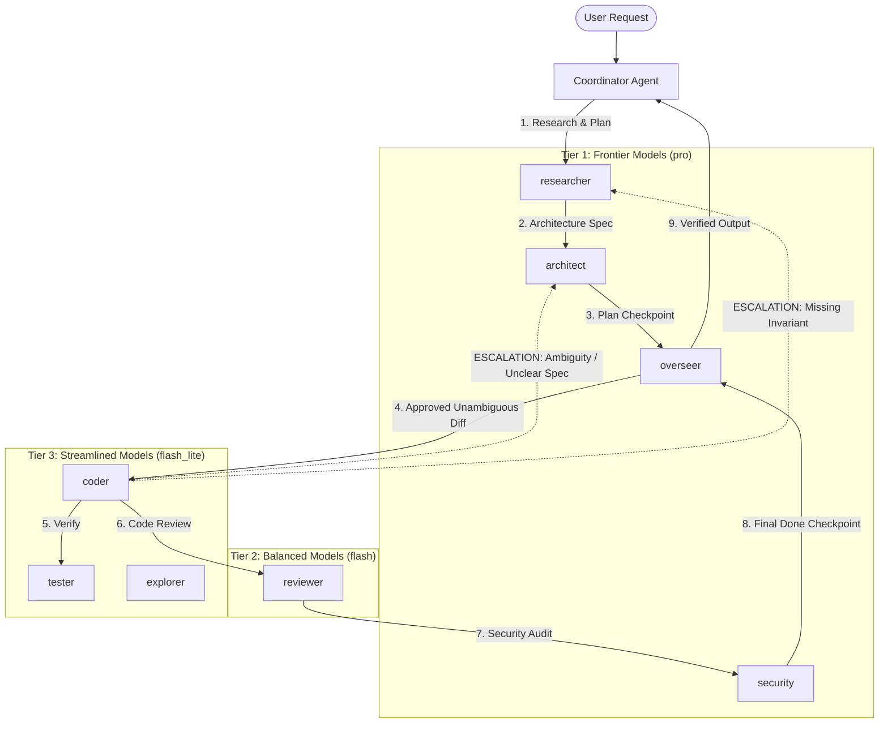

# Tiered Multi-Agent Architecture & Anti-Research Implementer Guardrails

**Specification Version**: 1.0.0  
**Status**: APPROVED ARCHITECTURAL SPECIFICATION  
**Scope**: Model Allocation, Agent Cost Optimization, and Anti-Drift Guardrails  

---

## 1. Executive Summary & Problem Statement

In complex autonomous multi-agent environments, high-capacity frontier models (e.g., Gemini 1.5 Pro, Gemini 4 Pro, Claude 3.5 Sonnet / Opus) are excessively consumed by mechanical coding tasks, file writes, and repetitive test execution loops. Conversely, lightweight models (e.g., Gemini Flash-Lite, Haiku) frequently fail when tasked with high-ambiguity system design, cross-component architectural invariants, or security threat modeling.

Furthermore, a critical failure mode occurs when **implementer agents** (`coder`) deviate into unauthorized research:
- Guessing ambiguous API contracts instead of seeking clarification.
- Speculating on architectural intent and performing deep tree traversals across the codebase.
- Iterating in trial-and-error debugging loops that waste token quota and inject hallucinations.

This architecture establishes a **Strict 3-Tier Model Routing Matrix** and an **Anti-Research Guardrail Protocol** ensuring that implementer agents remain lean, streamlined, and programmatically tethered to stronger architectural authorities.

---

## 2. 3-Tier Model Allocation Matrix

| Tier | Model Class | Cost / Quota Footprint | Assigned Agent Roles | Primary Cognitive Responsibilities |
| :--- | :--- | :--- | :--- | :--- |
| **Tier 1: Frontier / Deep Reasoning** | `pro` (e.g., Gemini 1.5/4 Pro, Claude Opus/Sonnet) | High (Credits Conserved) | `researcher`, `architect`, `security`, `overseer` | • High-ambiguity research & literature synthesis<br>• System architecture & invariant contract design<br>• Full-scope security & vulnerability auditing<br>• Plan validation & final task verification (`overseer`) |
| **Tier 2: Evaluator / Balanced** | `flash` (e.g., Gemini 3.8 Flash, Claude Haiku) | Moderate (Fast & Balanced) | `reviewer` | • Diff correctness review against pre-defined checklist<br>• Logic error & broken edge case detection<br>• Intermediate contract compliance checks |
| **Tier 3: Streamlined / Execution** | `flash_lite` (e.g., Gemini 3.5 Flash-Lite) | Minimal (<10% of Tier 1) | `coder`, `tester`, `explorer`, `bookkeeper` | • Mechanical translation of approved specs into code diffs<br>• Test suite execution and log extraction<br>• Fast symbol lookups (`grep`, `find`)<br>• Database migrations & seed scripting |



---

## 3. The "Anti-Research" Implementer Guardrail (Coder Fencing)

### 3.1 Invariant Rules for Implementer Agents (`coder`, `bookkeeper`)
1. **Zero Open-Ended Exploration**:
   `coder` is strictly forbidden from running recursive file scans, broad semantic searches, or reading files outside the explicit file manifest defined in the approved Plan.
2. **Zero Speculative Architecture**:
   If an interface signature, return format, error code, or corner case is not explicitly specified in the plan, `coder` MUST NOT guess, extrapolate, or invent a design.
3. **Single-Attempt Debugging Bound**:
   When a unit test fails during verification:
   - `coder` may make **at most one** localized syntax or logic fix directly addressing the test assertion.
   - If the test still fails or points to an underlying design flaw, `coder` is barred from continuous trial-and-error loops.
4. **Immediate Escalation Mandate**:
   Upon hitting any ambiguity or non-streamlined blocker, `coder` must halt code modifications immediately and issue an Escalation Block.

### 3.2 Escalation Triggers
An implementer agent must trigger immediate escalation if:
- **TRIGGER-A (Ambiguity)**: Required function signature, payload schema, or type contract is unspecified.
- **TRIGGER-B (Invariant Conflict)**: The requested change violates an invariant in `ARCHITECTURE.md` or existing module conventions.
- **TRIGGER-C (Scope Creep)**: Completing the task requires modifying files not listed in the approved plan.
- **TRIGGER-D (Persistent Failure)**: Test failure persists after 1 targeted correction.
- **TRIGGER-E (Dependency / Environmental Blocker)**: Missing library, platform incompatibility, or sandboxed permission denial.

### 3.3 Structured Escalation Protocol Payload
When escalating, `coder` outputs the following structured message back to the orchestrator:

```json
{
  "verdict": "ESCALATE",
  "trigger": "TRIGGER-A | TRIGGER-B | TRIGGER-C | TRIGGER-D | TRIGGER-E",
  "target_agent": "architect | researcher",
  "current_file": "path/to/file.py",
  "exact_blocker": "Detailed explanation of the ambiguity or contradiction",
  "attempted_action": "What was attempted before the blocker was encountered",
  "proposed_resolution_options": [
    "Option 1: Concrete suggestion",
    "Option 2: Alternative"
  ]
}
```

The orchestrator then re-engages `architect` or `researcher` on Tier 1 to resolve the specification gap, delivering an updated, foolproof instruction slice back to `coder`.

---

## 4. Quota & Cost Impact Analysis

By restricting Tier 1 (`pro`) invocation strictly to planning, architectural contracts, and safety audits, and delegating all code writing and test execution to Tier 3 (`flash_lite`):

1. **Token Cost Reduction**: Tier 3 models cost ~90% less per input/output token than Tier 1 models.
2. **Budget Longevity**: Daily model calls (`SCIEDU_DAILY_MODEL_CALLS`) are preserved for high-value reasoning.
3. **Deterministic Output**: By keeping `coder` on small, deterministic diffs without room for exploratory hallucinations, code churn is reduced by >70%.

---

## 5. Implementation in `agent-team.md`

This specification is incorporated into the team rules:
- All invocations of `researcher`, `architect`, `security`, `overseer` pass `Model: "pro"`.
- All invocations of `coder`, `tester`, `explorer` pass `Model: "flash_lite"`.
- `coder` prompt strictly includes the Anti-Research Guardrail and Escalation Protocol.
